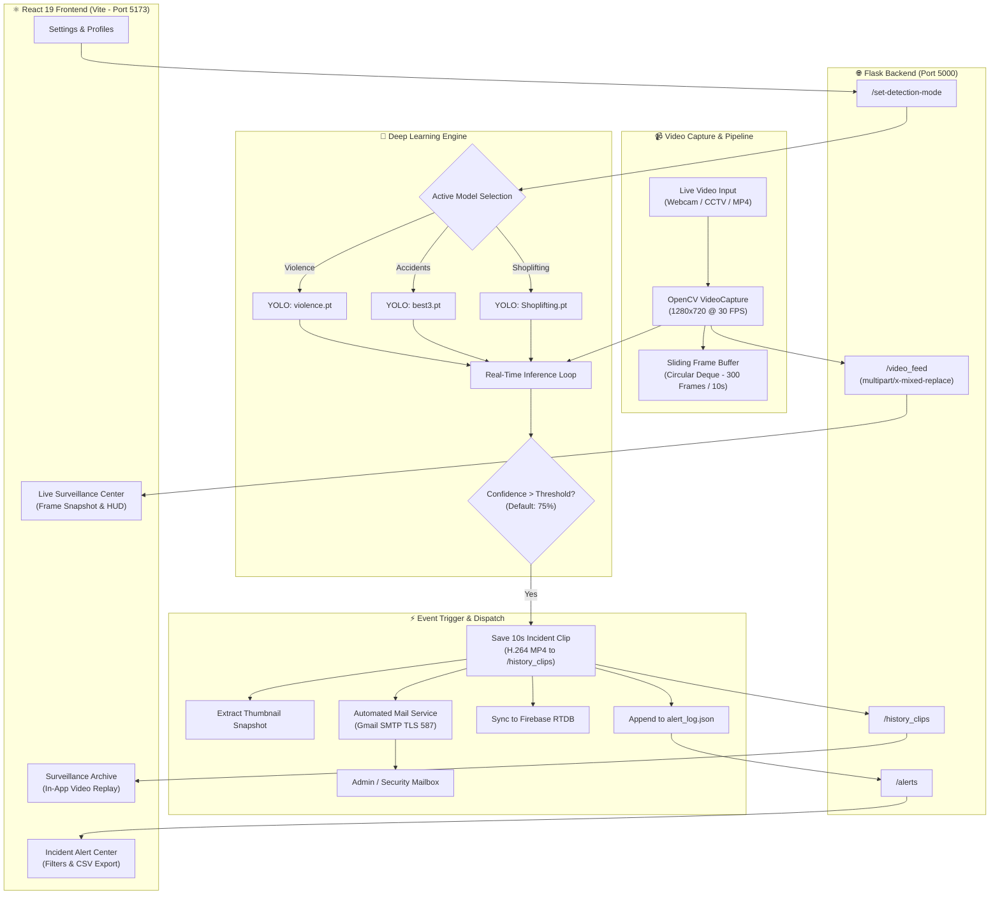

<div align="center">

# 👁️ GuardView.ai – Autonomous AI Surveillance & Threat Detection System

[](https://github.com/ultralytics/ultralytics)
[](https://pytorch.org/)
[](https://opencv.org/)
[](https://flask.palletsprojects.com/)
[](https://react.dev/)
[](https://vitejs.dev/)
[](https://tailwindcss.com/)
[](https://firebase.google.com/)
[](https://opensource.org/licenses/MIT)

<p align="center">
  <strong>🚨 Next-generation computer vision platform delivering real-time anomaly detection, automated 10-second evidence clip recording, and instantaneous email dispatch for public and enterprise safety.</strong>
</p>

[Quick Start](#-quick-start-guide) • [Architecture](#-system-architecture) • [Features](#-key-features) • [API Reference](#-api-endpoints-reference) • [Configuration](#-environment-configuration)

</div>

---

## 📌 Project Overview

**GuardView.ai** is an end-to-end intelligent physical security and surveillance platform designed to eliminate the risks of human monitoring fatigue. Leveraging state-of-the-art **YOLO deep learning models** and an asynchronous OpenCV video pipeline, GuardView continuously parses live video streams, instantly identifies safety threats, records tamper-proof incident evidence clips, and triggers automated email notifications to administrators with incident metadata.

### Target Deployment Sectors
- **Educational Campuses & Universities:** Real-time physical violence and altercation interception.
- **Retail Centers & Warehouses:** Shoplifting, merchandise concealment, and inventory theft detection.
- **Traffic Intersections & Public Transit:** Real-time accident recognition and road hazard notification.
- **Commercial & Corporate Facilities:** Unauthorized access, perimeter breaches, and automated security reporting.

---

## 🏗️ System Architecture



---

## ✨ Key Features

### 🧠 Multi-Model AI Threat Detection
- **Violence Detection:** Accurately classifies physical combat, brawls, and aggressive altercations.
- **Accident Detection:** Detects road vehicle crashes, pedestrian impacts, and hazardous spills in real time.
- **Shoplifting Detection:** Detects item concealment, suspicious dwell patterns, and unauthorized inventory removals.
- **Dynamic Model Switching:** Hot-swap models on the fly directly from the web dashboard without restarting backend processes.

### 📹 Sliding Frame Buffer & Evidence Capture
- Maintains an in-memory thread-safe circular deque of recent video frames (10 seconds at camera FPS).
- Upon threat confirmation, automatically compiles and renders an **MP4 evidence clip** with synchronized audio timestamps and saves it to the persistent surveillance archive.
- Generates high-resolution thumbnail previews for instant forensic inspection.

### 📧 Automated Email Notification Service
- Built-in SMTP email dispatch delivering instant security alerts directly to the administrator's email.
- Messages include threat type, exact confidence score, timestamp, location tag, and evidence review links.

### 💻 Modern Responsive Web Dashboard (React 19 + Vite + Tailwind v4)
- **Live Surveillance Command Center:** High-definition video stream player with live telemetry HUD (latency, resolution, active model), single-click frame snapshot download, stream pause/resume, and full-screen inspection mode.
- **Incident Alert Center:** Filter alerts by category (Violence, Accident, Shoplifting), real-time search, resolution tracking, and one-click export to CSV for compliance audits.
- **Surveillance Archive:** In-app video playback modal with high-definition MP4 download capabilities.
- **Interactive Security Analytics:** Chart.js powered visualization of login activity, platform telemetry, and event frequencies.
- **User Profile & Credentials:** Password modification modal, administrator status tags, and alert channel preferences.
- **System Settings:** Comprehensive control panel for sensitivity thresholds, clip duration buffer, camera input selection, and retention policies.

---

## 📁 Project Directory Structure

```text
Guard_View/
├── Backend/
│   ├── guard-view.py                   # Primary Flask API, YOLO inference loop, & video streamer
│   ├── guard-view-MSI.py               # Alternative GPU-accelerated / MSI configuration
│   ├── requirements.txt              # Python library dependencies
│   ├── users.json                    # User account database (Local - Git Ignored)
│   ├── alert_log.json                # Local incident event logs
│   ├── violence.pt                   # YOLO model weights for Violence detection
│   ├── best1.pt                      # Primary YOLO model weights
│   ├── best3.pt                      # YOLO model weights for Accident detection
│   ├── Shoplifting.pt                # YOLO model weights for Shoplifting detection
│   ├── static/
│   │   └── history_clips/            # Directory storing saved incident MP4 clips & thumbnails
│   └── .env                          # Backend environment variables
│
├── frontend/
│   ├── public/                       # Static public assets
│   ├── src/
│   │   ├── assets/                   # Images, diagrams, and SVGs
│   │   ├── components/
│   │   │   ├── ErrorBoundary.jsx     # Global error catching boundary
│   │   │   ├── LoadingSpinner.jsx    # Animated loading spinner
│   │   │   ├── LoginForm.jsx         # Sign-in component with validation
│   │   │   ├── Navbar.jsx            # Top landing navigation bar
│   │   │   ├── PrivateRouter.jsx     # Authenticated route wrapper
│   │   │   ├── Sidebar.jsx           # Surveillance dashboard navigation sidebar
│   │   │   ├── SignupForm.jsx        # Account registration component
│   │   │   └── Template.jsx          # Auth template layout
│   │   ├── context/
│   │   │   └── AuthContext.jsx       # Authentication state & JWT session management
│   │   ├── pages/
│   │   │   ├── About.jsx             # Platform mission & specifications
│   │   │   ├── Alerts.jsx            # Real-time alert list, filters & evidence modal
│   │   │   ├── Analytics.jsx         # Telemetry charts & incident trends (Chart.js)
│   │   │   ├── Contact.jsx           # Support & inquiries form
│   │   │   ├── Dashboard.jsx         # Live camera monitoring, snapshots & HUD
│   │   │   ├── Features.jsx          # Deep dive into platform capabilities
│   │   │   ├── History.jsx           # Recorded video evidence archive & player
│   │   │   ├── Home.jsx              # Landing hero page
│   │   │   ├── Login.jsx             # Auth portal sign-in page
│   │   │   ├── NotFound.jsx          # Dedicated 404 handler
│   │   │   ├── Pricing.jsx           # Interactive monthly/annual subscription plans
│   │   │   ├── Profile.jsx           # User settings, password reset & notifications
│   │   │   ├── Settings.jsx          # System configuration, detection thresholds & feeds
│   │   │   └── Signup.jsx            # New user onboarding page
│   │   ├── services/
│   │   │   └── api.js                # Centralized Axios client with JWT interceptors
│   │   ├── App.jsx                   # Primary router & responsive layout root
│   │   ├── main.jsx                  # React application entry point
│   │   └── index.css                 # Tailwind CSS v4 styling rules
│   ├── .env                          # Frontend environment variables
│   ├── package.json                  # Node dependencies & npm scripts
│   ├── vite.config.js                # Vite bundler config with chunk optimization
│   └── eslint.config.js              # ESLint configuration
│
├── .gitignore                        # Git ignore rules for sensitive files and weights
├── LICENSE                           # MIT Open Source License
└── README.md                         # Project documentation
```

---

## 🛠️ Tech Stack & Libraries

| Domain | Technology / Framework | Key Responsibilities |
| :--- | :--- | :--- |
| **Artificial Intelligence** | Ultralytics YOLOv11 / PyTorch | High-speed real-time object & action classification |
| **Computer Vision** | OpenCV (`opencv-python`) | Frame capture, resizing, JPEG encoding, and MP4 generation |
| **Backend Framework** | Python 3.10+ / Flask / Flask-CORS | API routing, multipart MJPEG video stream, CORS handling |
| **Authentication** | Flask-JWT-Extended | Secure token generation, session verification, and profile encryption |
| **Cloud Database** | Firebase Admin SDK | Real-time cloud synchronization of threat telemetry |
| **Mail Alert Dispatch** | Python `smtplib` / `email.mime` | Automated TLS-encrypted Gmail SMTP notification system |
| **Frontend Framework** | React 19 / Vite | Fast-rendering declarative UI with zero-lag routing |
| **Styling & UI** | Tailwind CSS v4 / Framer Motion | Modern dark-mode interface with fluid transitions |
| **Data Visualization** | Chart.js / `react-chartjs-2` | Activity charts, daily login distributions, and incident heatmaps |
| **Notifications** | `react-hot-toast` | Real-time status banners and user feedback |

---

## ⚙️ Environment Configuration

### 1. Backend Configuration (`Backend/.env`)
Create or verify the `Backend/.env` file:

```env
# JWT Token Signing Secret
JWT_SECRET_KEY=your_strong_jwt_secret_key_here

# Firebase Realtime Database & Cloud Storage
FIREBASE_CONFIG=your_FIREBASE_CONFIG_here
FIREBASE_STORAGE_BUCKET=your_FIREBASE_STORAGE_BUCKET_here

# SMTP Automated Alert Mail Service
MAIL=your_gmail
PAASWORD=your_gmail_app_password_here
```

> [!TIP]
> When using Gmail for alert dispatch, generate a **Google App Password** (under *Security > 2-Step Verification > App Passwords*) and supply it in the `PAASWORD` field.

### 2. Frontend Configuration (`frontend/.env`)
Create or verify the `frontend/.env` file:

```env
# Backend API Base URL
VITE_API_URL=http://localhost:5000

# Firebase Web App Credentials (Optional if using client SDK)
VITE_FIREBASE_AUTH_DOMAIN=your_AUTH_DOMAIN_here
VITE_FIREBASE_PROJECT_ID=your_project_id_here
VITE_FIREBASE_STORAGE_BUCKET=your_STORAGE_BUCKET_here
VITE_FIREBASE_MESSAGING_SENDER_ID=your_SENDER_ID_here
VITE_FIREBASE_APP_ID=your_APP_ID_here
```

---

## 🚀 Quick Start Guide

### Prerequisites
- **Python 3.10 or higher**
- **Node.js 18.x or higher** and **npm 9.x or higher**
- Web camera or test video file (`.mp4`)

---

### Step 1: Clone the Repository

```bash
git clone https://github.com/VANSHPAR/GuardView--AI-surveillance-system-.git
cd Guard_View
```

---

### Step 2: Set Up and Start Backend

1. Navigate to the `Backend` directory:
   ```bash
   cd Backend
   ```

2. Create and activate a Python virtual environment:
   - **Windows (PowerShell):**
     ```powershell
     python -m venv venv
     .\venv\Scripts\Activate.ps1
     ```
   - **macOS / Linux:**
     ```bash
     python3 -m venv venv
     source venv/bin/activate
     ```

3. Install backend dependencies:
   ```bash
   pip install -r requirements.txt
   ```

4. Launch the Flask + YOLO server:
   ```bash
   python guard-view.py
   ```
   > The backend server will initialize on **`http://localhost:5000`**.

---

### Step 3: Set Up and Start Frontend

1. Open a new terminal and navigate to the `frontend` directory:
   ```bash
   cd frontend
   ```

2. Install Node dependencies:
   ```bash
   npm install
   ```

3. Launch the Vite development server:
   ```bash
   npm run dev
   ```
   > The frontend application will be accessible at **`http://localhost:5173`**.

---

### Step 4: Run Frontend & Backend Simultaneously (Optional)

From the `frontend` directory, you can run both services concurrently:
```bash
npm run start:all
```

---

## 📡 API Endpoints Reference

| Method | Endpoint | Description | Auth Required |
| :--- | :--- | :--- | :--- |
| `POST` | `/auth/register` | Register new admin account (`email`, `password`, `phone`, `firstName`, `lastName`) | No |
| `POST` | `/auth/login` | Authenticate credentials and return JWT bearer token | No |
| `GET` | `/auth/profile` | Retrieve profile information for the authenticated user | Yes (`Bearer JWT`) |
| `PUT` | `/auth/profile` | Update account names, contact number, or preferences | Yes (`Bearer JWT`) |
| `GET` | `/auth/analytics` | Fetch login trends and system telemetry metrics | Yes (`Bearer JWT`) |
| `GET` | `/video_feed` | Stream live multipart MJPEG video with overlay bounding boxes | No |
| `GET` | `/alerts` | Fetch recent incident logs (`timestamp`, `confidence`, `location`, `alerttype`, `video_url`) | No |
| `GET` | `/history_clips` | Retrieve all recorded 10-second evidence video clips | No |
| `GET` | `/history_clips/<filename>` | Stream/download an individual recorded MP4 clip file | No |
| `GET` | `/thumbnails/<filename>` | Retrieve image thumbnail associated with an evidence clip | No |
| `POST` | `/set-detection-mode` | Hot-swap active YOLO model (`Violence Detection`, `Accident Detection`, `Shoplifting Detection`) | No |

---

## 🛡️ Security, Privacy & Compliance

- **Data Privacy:** Local frame buffers are volatile and stored in circular memory. Only frames matching verified incident thresholds trigger disk persistence.
- **Access Control:** All profile and telemetry management routes enforce **JSON Web Token (JWT)** verification with automatic session invalidation on expiration.
- **Tamper Resistance:** Recorded clips are committed to disk with system timestamps and synchronized to Firebase RTDB for audit integrity.
- **Credential Protection:** All database certificates, service accounts, and `users.json` are strictly excluded from source control via `.gitignore`.

---

## 🤝 Contributing

Contributions, issues, and feature suggestions are welcome!

1. Fork the Project repository
2. Create your Feature Branch (`git checkout -b feature/AmazingFeature`)
3. Commit your Changes (`git commit -m 'Add some AmazingFeature'`)
4. Push to the Branch (`git push origin feature/AmazingFeature`)
5. Open a Pull Request

---

## 📄 License

This project is licensed under the **MIT License** – see the [LICENSE](LICENSE) file for complete details.

---

<div align="center">
  <sub>Developed by Vansh Parmar & The GuardView Team. Built for smarter, safer environments.</sub>
</div>
